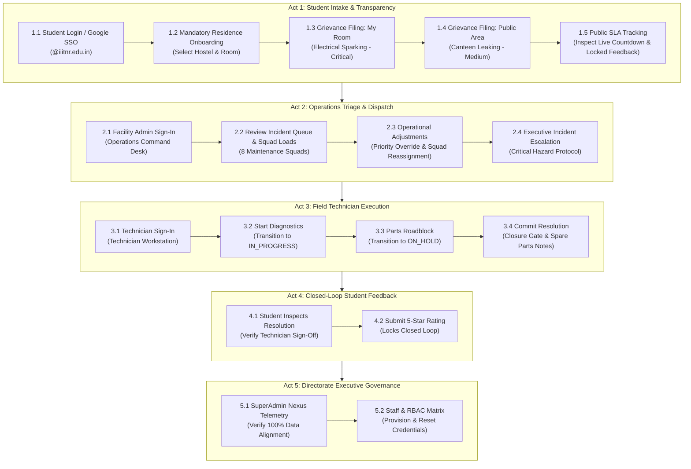

# SmartComplaintHandler - Realistic End-to-End (E2E) QA Testing Guide

> **Focus**: Simulating the authentic, natural campus user lifecycle from the perspective of students, supervisors, field technicians, and executive leadership. Every step includes real-world scenarios and edge cases that users naturally encounter.

---

## 1. Overview of the Closed-Loop Journey

---

## 2. Test Accounts & Baseline Credentials

| Persona | Email | Password | Scope & Role |
| :--- | :--- | :--- | :--- |
| **Student** | Your Google Account or `aarav24100@iiitnr.edu.in` | `Student@1234` | Submits grievances, tracks SLA, provides post-repair feedback |
| **Estate Admin** | `admin@iiitnr.edu.in` | `Admin@1234` | Central facilities operations, incident queue triage, squad rebalancing |
| **Super Admin** | `superadmin@iiitnr.edu.in` | `SuperAdmin@2026` *(or `Admin@1234`)* | Directorate oversight, staff provisioning, master overrides |
| **Field Technician** | `tech.ramesh@iiitnr.edu.in` | `Password@123` *(or `IIITNR@2026`)* | Electrical squad field workstation, work execution, ticket closure |

---

## Act 1: The Student Experience (Onboarding & Intake)

### Step 1.1: Sign In or Register via Google SSO
1. Navigate to `/login` (or `/register`).
2. **Action A: Google Workspace SSO**:
   * Click **"Sign in with Google (@iiitnr.edu.in)"**.
   * Pick your institutional Google account.
   * **Verification**: Verify authentication succeeds with **no 401 error**.
3. **Action B: Institutional Email / Password Registration**:
   * If registering manually, enter `aarav24100@iiitnr.edu.in` and password `Student@1234`.
   * **Verification**: As you type, the preview card auto-detects your **Full Name**, **Batch ('2024)**, and **Department (DSAI / CSE / ECE)**.

---

### Step 1.2: Mandatory One-Time Residence Onboarding (`/residence-info`)
*Because this student profile is brand new and has no residence in the database, the system routes to `/residence-info`.*
1. **Verification**:
   - [ ] Verify there is **no phantom cached room** (no auto-filled `Room 331` from previous browser sessions).
   - [ ] Student Account card shows your auto-detected Department and Roll number.
2. Select your Hostel: `Raman House (Boys Hostel 1)`.
3. Select Floor: `3`, and enter or select Room Number: `Room 331` (or your chosen room).
4. Click **"Save & Continue"**.
5. **Verification**:
   - [ ] Profile updates in the database via `/api/v1/auth/profile`.
   - [ ] Automatically redirects to the Student Portal (`/student`).

---

### Step 1.3: File Grievance 1 — In-Room Defect (1-Tap "My Room")
1. Navigate to **File Grievance** (`/submit`).
2. **Location Selection**:
   * Notice **"🏠 My Room"** mode is pre-selected.
   * Verify your saved residence is shown: `Raman House (Boys Hostel 1) 📍 Room 331`.
3. **Issue Description**:
   * **Title**: `Ceiling fan regulator shorted and making popping noise`
   * **Description**: `The ceiling fan regulator knob is loose and sparking whenever switched on. Burning plastic smell noticed in Room 331.`
4. **Live AI Triage Verification**:
   * [ ] **Category**: Evaluates to **Electrical**.
   * [ ] **Priority**: Evaluates to **CRITICAL** (due to sparking/burning).
   * [ ] **Target SLA**: Shows strict **2-Hour SLA**.
5. Click **Submit Request**.
6. **Save the generated Tracking Code**: (e.g. `TICK-1001`).

---

### Step 1.4: File Grievance 2 — Public Campus Area Defect (Quick Search / Map)
*Simulates a student reporting a defect outside their room (e.g., in a classroom, lab, or canteen).*
1. Navigate to `/submit`.
2. **Location Selection**:
   * Click **"🔍 Quick Search"** (or **"🗺️ Browse / Map"**).
   * In the spot search input, type: `Canteen` (or click the Canteen building on the interactive campus map).
   * Select `Canteen IIIT Naya Raipur (Circular Rotunda & Arcade)`.
   * Set specific spot: `Ground Floor Dining Hall near water cooler`.
3. **Issue Description**:
   * **Title**: `Water cooler drain pipe cracked and flooding dining floor`
   * **Description**: `Commercial RO water unit drain elbow is cracked, pooling water across the dining pathway during meal hours.`
4. **Live AI Triage Verification**:
   * [ ] **Category**: Evaluates to **Plumbing**.
   * [ ] **Priority**: Evaluates to **MEDIUM** (or **HIGH**).
   * [ ] **Target SLA**: Shows **24-Hour SLA**.
5. Click **Submit Request**.
6. **Save the generated Tracking Code**: (e.g. `TICK-1002`).

---

### Step 1.5: Public Ticket Tracking & SLA Countdown (`/track`)
1. Open an incognito tab or log out, then navigate to `/track`.
2. Enter Tracking Code `TICK-1001` and press Enter.
3. **Verification**:
   - [ ] Ticket header shows priority tag (`CRITICAL`) in rose badge.
   - [ ] **Live SLA Countdown Timer**: Real-time ticking timer (e.g. `01h 59m remaining`).
   - [ ] Location displays `Raman House (Boys Hostel 1) - Room 331`.
   - [ ] Status Timeline displays `SUBMITTED` marked with checkmark and active `ASSIGNED` stage.
   - [ ] **Student Feedback Section**: Form is cleanly locked with notice: *"Feedback can be submitted once this ticket is resolved."*

---

## Act 2: Operations Command Desk & Triage Dispatch (`/operations`)

### Step 2.1: Supervisor Sign-In
1. Sign in as **Estate Admin** (`admin@iiitnr.edu.in` / `Admin@1234`) or **Super Admin** (`superadmin@iiitnr.edu.in` / `SuperAdmin@2026`).
2. Navigate to **Operations Desk** (`/operations`).
3. **Verification**:
   - [ ] Page loads directly **without redirect loops**.
   - [ ] **Squad Capacities Panel**: Shows the 8 maintenance squads (Electrical Squad 1, Plumbing Squad 2, etc.) with real-time active load counts.
   - [ ] **Campus Incident Queue**: Both newly filed tickets (`TICK-1001` and `TICK-1002`) are present in the table.

---

### Step 2.2: Test Operational Action Modals (Handling Real Roadblocks)

#### Action 2.2A: Priority Override (Plumbing Ticket `TICK-1002`)
*Real-world problem: A leak in a busy dining hall during meal rush poses an urgent slipping hazard and needs faster attention than routine 24h maintenance.*
1. Locate `TICK-1002` in the incident queue.
2. Click the **Priority Override (Sliders)** button.
3. In the modal:
   * Target Priority: Select **HIGH** (8-Hour SLA).
   * Reason: *"Active slip hazard across main dining hall walkway during lunch hour."*
   * Click **Save Priority Override**.
4. **Verification**:
   - [ ] Toast notification confirms update.
   - [ ] Priority badge updates to `HIGH` and countdown adjusts to an 8-hour window.

#### Action 2.2B: Squad Reassignment
*Real-world problem: The ticket requires specialized high-voltage intervention or different crew equipment.*
1. Locate `TICK-1001`.
2. Click the **Reassign Squad (Users)** button.
3. Select squad: `Substation High-Voltage Team` (or target squad).
4. Enter reason: *"Primary panel arcing requires high-voltage technician toolkit."*
5. Click **Confirm Reassignment**.
6. **Verification**: Assigned squad updates in the table immediately.

#### Action 2.2C: Directorate Escalation
1. Click the **Escalate (Alert Triangle)** action on `TICK-1001`.
2. Enter reason: *"Repeated arcing threatens floor distribution breaker."*
3. Click **Confirm Escalation**.
4. **Verification**: Status updates to `ESCALATED`.

---

## Act 3: Field Technician Execution (`/technician`)

### Step 3.1: Technician Sign-In
1. Sign in as Field Technician:
   * **Email**: `tech.ramesh@iiitnr.edu.in`
   * **Password**: `Password@123` *(or `IIITNR@2026`)*
2. Navigate to `/technician` (Technician Workstation).
3. **Verification**:
   - [ ] Assigned squad work orders queue displays ticket `TICK-1001`.
   - [ ] Displays location: `Raman House (Room 331)`.

---

### Step 3.2: Begin Field Diagnostics (`IN_PROGRESS`)
1. Click **"Start Work"**.
2. **Verification**:
   - [ ] Ticket status transitions to **IN_PROGRESS**.
   - [ ] Student tracking page reflects that technician has arrived on-site and commenced repair.

---

### Step 3.3: Parts Roadblock Protocol (`ON_HOLD`)
*Real-world scenario: The technician inspects the damage and realizes replacement 32A breaker parts must be fetched from central stores.*
1. Click **"Put On Hold"** (or pause work action).
2. Enter justification: *"Awaiting replacement 32A DIN-rail breaker from central institutional inventory."*
3. Click **Confirm On Hold**.
4. **Verification**:
   - [ ] Status transitions to **ON_HOLD**.
   - [ ] Queue card shows hold notice.

---

### Step 3.4: Complete Physical Repair & Commit Resolution Notes (`RESOLVED`)
1. Click **"Resolve Ticket"**.
2. The **Ticket Closure Gate** modal opens (`ResolutionNotesModal`).
3. Fill in mandatory resolution audit details:
   * **Physical Work Completed**: `Replaced burned-out 32A breaker with new industrial unit, cleaned contacts, and verified voltage balance across phases.`
   * **Parts Replaced**: `1x 32A C-Curve Breaker, 2x 6mm terminal lugs`
   * **Technician Sign-Off**: `Ramesh Kumar (Electrical Lead)`
4. Click **Confirm Resolution & Close**.
5. **Verification**:
   - [ ] Ticket transitions to **RESOLVED**.
   - [ ] Moved to Resolved tab in technician workstation.

---

## Act 4: Closed-Loop Student Verification & Feedback (`/track`)

### Step 4.1: Inspect Completed Ticket
1. Re-open `/track` and search `TICK-1001` (or view your complaint in `/student`).
2. **Verification**:
   - [ ] Status banner displays **RESOLVED** in green.
   - [ ] SLA status displays **RESOLVED ON TIME**.
   - [ ] Displays technician resolution notes: *"Replaced burned-out 32A breaker..."*
   - [ ] Technician sign-off: `Ramesh Kumar (Electrical Lead)`.

---

### Step 4.2: Submit 5-Star Satisfaction Rating
1. Notice the rating section is now **unlocked**.
2. Click the **5th Star** (Rating: `5/5`).
3. Comments: *"Technician arrived promptly, fixed the sparking breaker, and tested all power outlets safely. Excellent work!"*
4. Click **Submit Feedback & Rating**.
5. **Verification**:
   - [ ] Rating locks with green checkmark confirmation.
   - [ ] Feedback is stored permanently in Supabase.

---

## Act 5: Directorate Executive Governance (`/superadmin` & `/superadmin/staff`)

### Step 5.1: Verify Directorate Telemetry
1. Sign back in as SuperAdmin (`superadmin@iiitnr.edu.in`).
2. Open `/superadmin` (Nexus Dashboard) and `/operations`.
3. **Verification**:
   - [ ] **Resolution Rate**: Incremented to reflect completed ticket.
   - [ ] **Active Incidents**: Decremented.
   - [ ] **Incident Queue**: `TICK-1001` now displays in Resolved state.

---

### Step 5.2: Staff & RBAC Governance (`/superadmin/staff`)
1. Click **Staff Directory** (`/superadmin/staff`).
2. Click **Provision Staff Account**:
   * **Full Name**: `Sunil Verma`
   * **Email**: `tech.sunil@iiitnr.edu.in`
   * **Role**: `TECHNICIAN`
   * **Department**: `Plumbing`
   * Click **Confirm & Authorize**.
3. **Verification**:
   - [ ] Sunil Verma appears in the directory with `TECHNICIAN` badge.
4. **Test Password Override (`SetPasswordModal`)**:
   * Click the Key icon on Sunil Verma's card.
   * Enter new password: `NewPassword@2026`.
   * Click **Save Password**.
   * Verify toast confirms password update.
5. **Test Role Filters**:
   * Filter by `TECHNICIAN` -> shows only technicians.
   * Filter by `ADMIN` -> shows only admins.
   * Filter by `ALL` -> shows full staff directory.

---

## 3. QA Testing Sign-Off Checklist

| Test Phase | Persona | Target Route | Expected Outcome | Status |
| :--- | :--- | :--- | :--- | :--- |
| **1.1 Google SSO** | Student | `/login` / `/register` | Clean token exchange with no 401 error | [ ] |
| **1.2 Residence Setup** | Student | `/residence-info` | Clean dropdowns without phantom cache; saves to DB | [ ] |
| **1.3 In-Room Grievance** | Student | `/submit` | 1-Tap "My Room" pre-filled; Critical 2h SLA evaluated | [ ] |
| **1.4 Public Area Grievance** | Student | `/submit` | Quick Search/Map selects Canteen; 24h SLA evaluated | [ ] |
| **1.5 SLA Tracking** | Student | `/track` | Live countdown active; rating locked until resolved | [ ] |
| **2.1 Operations Desk** | Admin | `/operations` | Direct access without bounce; 8 squads & incident queue visible | [ ] |
| **2.2 Priority Override** | Admin | `/operations` | Modal upgrades Plumbing to High (8h SLA) with justification | [ ] |
| **2.3 Squad Reassignment** | Admin | `/operations` | Reassigns ticket to target maintenance squad | [ ] |
| **3.1 Start Work** | Technician | `/technician` | Transitions ticket to `IN_PROGRESS` | [ ] |
| **3.2 Hold Protocol** | Technician | `/technician` | Transitions ticket to `ON_HOLD` with parts reason | [ ] |
| **3.3 Resolution Gate** | Technician | `/technician` | Closure modal captures physical work and parts; sets `RESOLVED` | [ ] |
| **4.1 Student Review** | Student | `/track` | Audit notes visible; 5-star rating submitted and locked | [ ] |
| **5.1 Executive Telemetry**| SuperAdmin | `/superadmin` | Real-time counters reflect closed loop | [ ] |
| **5.2 Staff Management** | SuperAdmin | `/superadmin/staff` | New technician provisioned; password override tested | [ ] |
