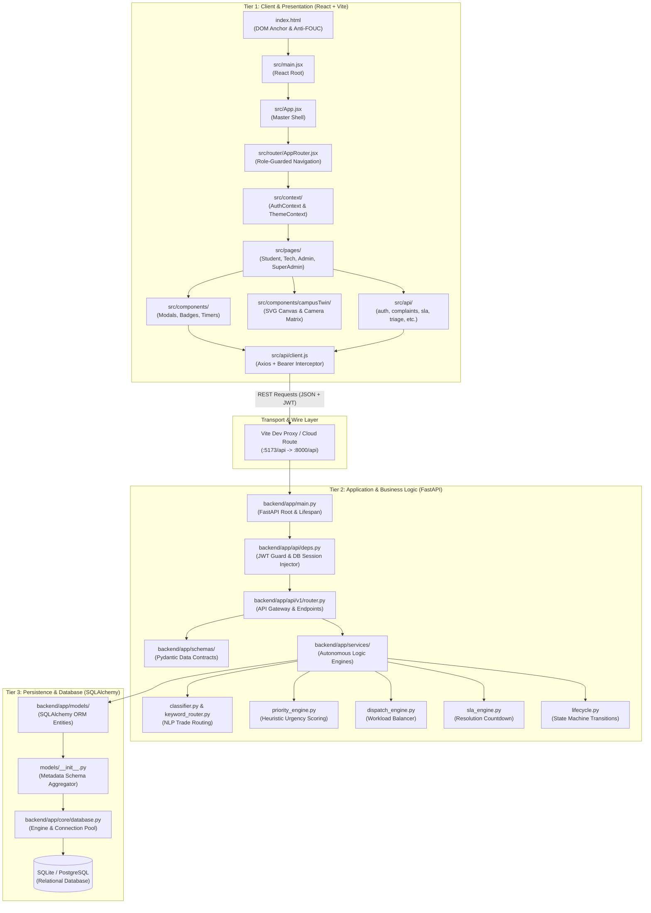
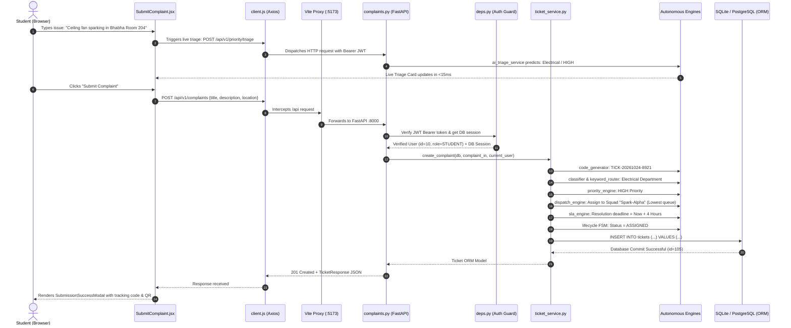

# SmartComplaintHandler — Full-Stack Architecture & System Connection Guide

> **Navigation**: [🏠 Project Root](../README.md) &nbsp;│&nbsp; [👥 5-Student Responsibility Matrix](TEAM_RESPONSIBILITY_MATRIX.md) &nbsp;│&nbsp; [📚 Codebase Documentation Hub](codebase/README.md) &nbsp;│&nbsp; [🗺️ Master Roadmap](DOCUMENTATION_ROADMAP.md) &nbsp;│&nbsp; [📄 Product Design Report](PRODUCT_DESIGN_REPORT_PDR.md)  
> **Target Audience**: College Viva Examiners, Project Review Committees, Technical Interviewers, and Software Engineers.  
> **Repository Branch**: `documentation`  
> **Core Architecture**: Modern 3-Tier Decoupled Client-Server Single-Page Application (SPA) with Autonomous Business Engines and 2D Digital Twin Cartography.

---

## 1. What Makes This a "Full-Stack" Application?

In computer science and software engineering, a **Full-Stack Application** is a complete, production-ready system that spans all layers of modern computing. Rather than just being a visual mock-up (frontend only) or a headless script (backend only), **SmartComplaintHandler** implements a complete, end-to-end 3-Tier Enterprise Architecture:

```
┌─────────────────────────────────────────────────────────────────────────────┐
│                       TIER 1: PRESENTATION LAYER                            │
│  React 18 SPA + Vite + Tailwind CSS + Interactive 2D Digital Twin SVG       │
│  (State: Context API, Hooks; Styling: JIT Utility CSS; Routing: React Router) │
└──────────────────────────────────────┬──────────────────────────────────────┘
                                       │ HTTP / HTTPS (REST API)
                                       │ JSON Payloads + JWT Bearer Tokens
                                       ▼
┌─────────────────────────────────────────────────────────────────────────────┐
│                    TIER 2: APPLICATION & LOGIC LAYER                        │
│  FastAPI (Python 3.14) + Pydantic v2 + Autonomous Algorithmic Engines       │
│  (Auth: Passlib/Bcrypt/OAuth2; NLP Triage; Priority Scoring; Dispatch Balancer; │
│   SLA Monitor; Finite State Machine; Dependency Injection Gatekeeper)       │
└──────────────────────────────────────┬──────────────────────────────────────┘
                                       │ SQLAlchemy 2.0 ORM Engine
                                       │ Thread-Safe Connection Pooling
                                       ▼
┌─────────────────────────────────────────────────────────────────────────────┐
│                       TIER 3: DATA & PERSISTENCE LAYER                      │
│  Relational Database (SQLite / PostgreSQL) + Declarative Schemas            │
│  (Tables: Users, Tickets, Departments, Teams, Buildings, Roads; Seed Data)  │
└─────────────────────────────────────────────────────────────────────────────┘
```

### The 4 Pillars That Define This Full-Stack System:
1. **Presentation & Client Tier**: Dynamic, stateful user interfaces for 4 distinct user roles (Students, Technicians, Supervisors, Directorate SuperAdmins), complete with a real-time 2D vector Digital Twin map rendered in declarative SVG.
2. **Transport & Network Tier**: Decoupled asynchronous REST API communicating via JSON over HTTP, guarded by JWT (JSON Web Token) bearer credentials and local development reverse proxies.
3. **Application & Business Logic Tier**: High-throughput FastAPI application running autonomous algorithmic engines (NLP complaint classifier, weighted heuristic priority calculator, squad workload balancing dispatcher, and proactive SLA breach monitors).
4. **Data & Persistence Tier**: Strictly structured relational database tables governed by SQLAlchemy ORM with foreign key cascades, unique indexes, and automated timestamping.

---

## 2. End-to-End System Architecture & File Connections

The following diagram illustrates how every folder and file category connects across the entire repository:



---

## 3. Detailed File Breakdown & Inter-Connectivity

### Layer 1: Client & Presentation (Frontend)
| File / Directory | Direct Purpose | How It Connects to the Rest of the Stack |
| :--- | :--- | :--- |
| [`frontend/index.html`](codebase/frontend/index.html.md) | Single HTML page delivered by server; contains root `<div>` and anti-FOUC theme script. | Mounts `main.jsx`; loads Google GSI library and Google fonts. |
| [`frontend/src/main.jsx`](codebase/frontend/src/main.jsx.md) | JavaScript entrypoint instantiating `ReactDOM.createRoot`. | Injects `App.jsx` into `<div id="root">`; imports `globals.css`. |
| [`frontend/src/App.jsx`](codebase/frontend/src/App.jsx.md) | Root component setting up application providers. | Wraps application in `ThemeProvider`, `AuthProvider`, and `AppRouter`. |
| [`frontend/src/router/AppRouter.jsx`](codebase/frontend/src/router/AppRouter.jsx.md) | Client-side routing engine mapping URLs to page components. | Reads `currentUser.role` from `AuthContext` to protect admin/tech routes. |
| [`frontend/src/context/AuthContext.jsx`](codebase/frontend/src/context/AuthContext.jsx.md) | Global authentication state store. | Stores JWT tokens in `localStorage`; informs all pages of user identity. |
| [`frontend/src/api/client.js`](codebase/frontend/src/api/client.js.md) | Centralized Axios HTTP client. | Intercepts all outgoing calls to attach `Bearer <JWT>`; redirects to `/login` on 401. |
| [`frontend/src/api/*.js`](codebase/frontend/src/api/client.js.md) | Domain-specific API function libraries (`auth`, `complaints`, `sla`, etc.). | Called by UI pages; calls `client.js` to dispatch HTTP requests to FastAPI. |
| [`frontend/src/pages/*.jsx`](codebase/frontend/src/pages/Home.jsx.md) | Interactive role workstations (Student, Tech, Admin, SuperAdmin). | Renders UI; triggers API calls; displays modals and lists. |
| [`frontend/src/components/campusTwin/`](codebase/frontend/src/components/campusTwin/DigitalTwinCanvas.jsx.md) | Declarative SVG campus digital twin canvas and camera matrix hook. | Reads spatial data from `iiitnrCampusData.js`; renders interactive 2D map. |

---

### Layer 2: Application & Business Logic (Backend)
| File / Directory | Direct Purpose | How It Connects to the Rest of the Stack |
| :--- | :--- | :--- |
| [`backend/index.py`](codebase/backend/index.py.md) | Serverless execution adapter for cloud platforms (Vercel). | Injects `backend/` into `sys.path`; exports FastAPI `app` to cloud runtime. |
| [`backend/app/main.py`](codebase/backend/app/main.py.md) | Core FastAPI server setup, lifespan database startup, and CORS rules. | Mounts `/api/v1` router; initializes tables via `Base.metadata.create_all()`. |
| [`backend/app/core/config.py`](codebase/backend/app/core/config.py.md) | Environment configuration parser (`.env`). | Injects secrets, database paths, and CORS origins into `security.py` and `database.py`. |
| [`backend/app/core/security.py`](codebase/backend/app/core/security.py.md) | Cryptographic security utilities. | Hashes passwords with bcrypt; generates and verifies HS256 JWT tokens. |
| [`backend/app/api/deps.py`](codebase/backend/app/api/deps.py.md) | Dependency injection gatekeeper. | Injects `db` session (`get_db`) and authenticated `user` (`get_current_user`) into routes. |
| [`backend/app/api/v1/endpoints/*.py`](codebase/backend/app/api/v1/router.py.md) | REST route handlers (Auth, Complaints, Priority, Assignment, SLA). | Validates request bodies with Pydantic; invokes Service layer; returns JSON. |
| [`backend/app/schemas/*.py`](codebase/backend/app/schemas/ticket.py.md) | Pydantic data contracts and validation rules. | Validates data entering API endpoints and serializes data leaving for frontend. |
| [`backend/app/services/*.py`](codebase/backend/app/services/ticket_service.py.md) | Autonomous business logic engines. | Executes NLP classification, priority scoring, dispatch balancing, and SLA timers. |

---

### Layer 3: Persistence & Database (SQLAlchemy)
| File / Directory | Direct Purpose | How It Connects to the Rest of the Stack |
| :--- | :--- | :--- |
| [`backend/app/core/database.py`](codebase/backend/app/core/database.py.md) | SQLAlchemy database engine and session factory. | Creates connection pool; yields isolated DB sessions to `deps.py`. |
| [`backend/app/models/base.py`](codebase/backend/app/models/base.py.md) | Common model ancestor. | Provides `id`, `created_at`, and `updated_at` columns to all database tables. |
| [`backend/app/models/*.py`](codebase/backend/app/models/ticket.py.md) | ORM table entities (`User`, `Ticket`, `Department`, `Team`, `CampusBuilding`). | Defines relational schemas, column types, indexes, and foreign key relationships. |
| [`backend/app/models/__init__.py`](codebase/backend/app/models/__init__.py.md) | Model facade and metadata aggregator. | Imports all models together so SQLAlchemy's `Base.metadata` discovers all tables. |
| [`backend/app/db/seed.py`](codebase/backend/app/db/seed.py.md) | Database initial data seeder. | Populates verified departments, squads, test accounts, and facilities upon first run. |

---

## 4. The Life of a Request (End-to-End Walkthrough)

To ace a viva or technical interview, you must be able to trace **exactly what happens when a user clicks a button**. Below is the sequence of events when a student lodges a grievance:



---

## 5. High-Frequency Viva & Defense Master Guide

### Q1: Why did you build this as a Decoupled Single-Page Application (SPA) instead of server-rendered templates (like Django templates or Flask Jinja2)?
**Viva Answer**: 
1. **Separation of Concerns**: The frontend is completely decoupled from the backend. The backend only serves structured JSON via REST APIs, allowing the same backend to power mobile apps, IoT devices, or third-party campus systems without rewriting business logic.
2. **User Experience**: Page transitions happen instantly in the browser without full-page reloads, providing a smooth app-like feel.
3. **Optimized Server Load**: The server spends zero CPU cycles rendering HTML strings; it simply performs mathematical processing and database queries, drastically improving scalability.

---

### Q2: Why did you choose FastAPI over Flask or Django?
**Viva Answer**:
1. **High Performance**: FastAPI is built on Starlette and Uvicorn (ASGI), making it one of the fastest Python web frameworks available (comparable to NodeJS and Go).
2. **Automatic Data Validation**: FastAPI integrates Pydantic natively. Incoming JSON payloads are automatically validated against Python type hints, eliminating dozens of lines of manual `if not data.get(...)` checks.
3. **Interactive Documentation**: FastAPI automatically inspects function signatures and generates OpenAPI (Swagger UI) documentation at `/docs` with zero extra code.
4. **Native Asynchronous Support**: FastAPI supports Python's `async/await` syntax natively, enabling non-blocking concurrent request handling.

---

### Q3: Why do we have separate `schemas/` (Pydantic) and `models/` (SQLAlchemy)? Why not use one for both?
**Viva Answer**:
This follows the **Separation of Interface from Storage** principle:
- **`models/` (SQLAlchemy ORM)**: Defines the physical database schema (tables, columns, foreign keys, constraints). It dictates how data is stored on disk in SQLite/PostgreSQL.
- **`schemas/` (Pydantic)**: Defines the API data contracts (network transfer objects). It controls what data enters the API (request validation) and what data leaves the API (response serialization).
- **Security Benefit**: This prevents **over-posting / mass-assignment vulnerabilities**. For example, a user's database model contains `hashed_password` and `is_superuser`. If we returned the raw model directly, password hashes would leak over the network! By serializing through `UserResponse` schema, `hashed_password` is excluded automatically.

---

### Q4: How is security handled across the application?
**Viva Answer**:
1. **Credential Security**: Passwords are never stored in plaintext. They are salted and hashed using **bcrypt** via Passlib (`pwd_context.hash()`).
2. **Stateless Session Tokens**: Authentication generates **JSON Web Tokens (JWT)** signed with a server-side HMAC-SHA256 secret. Each token carries an expiration timestamp (`exp`).
3. **Role-Based Access Control (RBAC)**: Protected routes utilize FastAPI dependency injection (`Security(deps.require_role(["ADMIN"]))`). If a student attempts to invoke a technician endpoint, FastAPI halts execution immediately with an HTTP 403 Forbidden error.
4. **CORS & Reverse Proxying**: In production, strict CORS origins restrict access to verified domains. In development, Vite's reverse proxy routes `/api` traffic internally, satisfying the browser's Same-Origin Policy.

---

### Q5: How does the Digital Twin Map work without external mapping libraries like Google Maps or Leaflet?
**Viva Answer**:
The 2D digital twin is built using pure **Scalable Vector Graphics (SVG)**. 
1. Real satellite coordinates for IIIT Naya Raipur were normalized into a localized Cartesian grid (`viewBox="0 0 1000 800"`).
2. Buildings and roads are stored as declarative geometric paths (`campusGeometry.js`).
3. A custom React hook (`useMapCamera.js`) manages camera matrix transformations: panning modifies `viewBox` origin $(x, y)$, and zooming scales dimensions $(w, h)$ with boundary clamping.
4. Non-passive wheel event listeners intercept zooming natively, providing an interactive, zero-dependency cartographic map that loads in under $50\text{ms}$.

---

## 6. Quick Summary Cheat Sheet for Interviewers

| Tier | Primary Technologies | Core Architectural Patterns Used |
| :--- | :--- | :--- |
| **Frontend** | React 18, Vite, Tailwind CSS, Lucide Icons | Component Composition, Context API State, Custom Hooks, SVG Vector Math, Progressive Disclosure |
| **Transport** | Axios, REST, JSON, WebSockets, Vite Proxy | JWT Bearer Authentication, HTTP Request/Response Interceptors, Anti-CORS Proxying |
| **Backend** | FastAPI, Python 3.14, Pydantic v2, Starlette | Dependency Injection (DI), Finite State Machine (FSM), Multi-Stage Heuristic Triage, Asynchronous Event Loop |
| **Database** | SQLAlchemy 2.0, SQLite / PostgreSQL | Object-Relational Mapping (ORM), Declarative Base, Foreign Key Cascades, Connection Pooling |
| **DevOps** | Node.js, PostCSS, Autoprefixer, esbuild, Vercel | JIT CSS Purging, Multi-Chunk Code Splitting, Serverless ASGI Cloud Bridge |

---

## 🧭 Navigation Footer

> **Quick Jump**:  
> [🏠 Project Root](../README.md) &nbsp;│&nbsp; [👥 5-Student Responsibility Matrix](TEAM_RESPONSIBILITY_MATRIX.md) &nbsp;│&nbsp; [📚 Codebase Documentation Hub](codebase/README.md) &nbsp;│&nbsp; [🗺️ Master Roadmap](DOCUMENTATION_ROADMAP.md) &nbsp;│&nbsp; [📄 Product Design Report](PRODUCT_DESIGN_REPORT_PDR.md)
