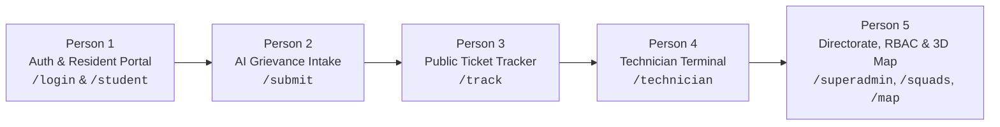

# Smart Complaint Handler — 5-Person Live Walkthrough Guide

An exhaustive, page-by-page feature breakdown and demonstration handbook for the Smart Complaint Handler platform at IIIT Naya Raipur.

---

## 1. Demonstration Topology & Module Allocation

### Presenter Quick-Reference Matrix

| Presenter | Target Pages | Persona / Role | Core Modules Covered |
| :--- | :--- | :--- | :--- |
| **Person 1** | `/login`, `/student` | Student (`student@iiitnr.edu.in`) | Institutional SSO/Auth, role redirection, resident portal & grievance roster |
| **Person 2** | `/submit` | Student (`student@iiitnr.edu.in`) | Intake form, AI NLP trade classification, automated urgency scoring, SLA matrix |
| **Person 3** | `/track` | Public / Student | 3-stage visual stepper, live countdown timer, obsidian audit trail, closure notes |
| **Person 4** | `/technician` | Field Staff (`tech@iiitnr.edu.in`) | Multi-squad switcher, repair triage, parts hold, supervisory escalation gate, closure proof |
| **Person 5** | `/superadmin`, `/superadmin/staff`, `/squads`, `/map` | Super Administrator (`superadmin@iiitnr.edu.in`) | Macro governance telemetry, daily/hourly charts, staff squad assignments, 3D campus twin |

---

## 2. Person 1: Authentication & Resident Portal

### Screen 1: Login & Access Control (`/login`)
- **Institutional Authentication**: Secure email and password entry with `@iiitnr.edu.in` domain verification.
- **Role-Based Dynamic Routing**: Instant clearance detection routing users to their tailored terminal:
  - `STUDENT` $\rightarrow$ `/student`
  - `STAFF / TECHNICIAN` $\rightarrow$ `/technician`
  - `ADMIN` $\rightarrow$ `/operations`
  - `SUPER_ADMIN` $\rightarrow$ `/superadmin`
- **First-Time Credential Enforcement**: Integrated interceptor detecting first-time or administrative temporary passwords, opening the secure Set/Reset Password modal.
- **Session Security & Persistence**: Cryptographic JWT bearer tokens stored securely with automatic refresh and clean logout session invalidation.
- **High-Density Error Handling**: Real-time visual feedback for invalid credentials, inactive accounts, or network latency.

### Screen 2: Resident / Student Portal (`/student`)
- **Resident Profile Header**: Displays student identity, registered department, and assigned residential block (e.g., Hostel Ramanujan).
- **Personal Grievance Roster**: Real-time table displaying all historical and active complaints filed by the authenticated student.
- **Reactive Status Badges**: High-contrast obsidian status indicators (`SUBMITTED`, `IN_PROGRESS`, `ON_HOLD`, `ESCALATED`, `RESOLVED`, `CLOSED`).
- **Direct Ticket Lookup Widget**: Fast-input search box allowing students to jump straight to any tracking code without scrolling.
- **Quick Action Gate**: Primary call-to-action button routing directly to the intake form (`/submit`).

---

## 3. Person 2: AI-Powered Grievance Intake Engine (`/submit`)

### Screen: File Official Grievance (`/submit`)

#### User Interface & Intake Controls
- **17 Campus Structures Dropdown**: Hierarchical building selector spanning Academic Blocks, Ramanujan Hostel, Bose Hostel, Dining Hall, Sports Complex, Substation, Labs, etc.
- **Precise Sub-Location Targeting**: Room, wing, and floor inputs to anchor exact physical coordinates.
- **Department / Trade Selector**: Primary category selection (Electrical, Plumbing, Sanitation, Carpentry, IT Support, General Facilities).
- **Validation Guards**: Minimum character thresholds (Subject $\ge 5$ chars, Description $\ge 10$ chars) preventing vague submissions.
- **Diagnostic Media Upload**: Attachment gateway for diagnostic photos or physical proof of defect.

#### Behind-the-Scenes AI Engine Features
- **NLP Trade Classification Engine**:
  - Analyzes natural language grievance text using TF-IDF tokenization and keyword classification.
  - Automatically verifies and corrects trade routing (e.g., detects `"tripping breaker"` and routes to *Electrical* even if submitted under *General*).
- **Automated Urgency & Priority Scoring**:
  - Scans for safety hazard keywords (e.g., `"sparking"`, `"gas leak"`, `"water burst"` $\rightarrow$ `CRITICAL`).
  - Assigns authoritative urgency tier: `CRITICAL`, `HIGH`, `MEDIUM`, or `LOW`.
- **Semantic Deduplication**:
  - Cross-references incoming complaints against open tickets within the same campus building and floor.
  - Prevents queue flooding by flagging clustered or duplicate reports.
- **Automated SLA Matrix Allocation**:
  - Binds contractual resolution deadlines based on assigned priority:
    - **CRITICAL**: 2-Hour SLA (Urgent facility hazard / disruption)
    - **HIGH**: 8-Hour SLA (Classroom or laboratory disruption)
    - **MEDIUM**: 24-Hour SLA (Routine residential maintenance)
    - **LOW**: 72-Hour SLA (Cosmetic or scheduled upgrade)

#### Submission Confirmation Modal
- **Institutional Tracking Code Issuance**: Instant generation of tracking identifier (e.g., `TICK-LILW`).
- **One-Click Tracking Redirect**: Copy-to-clipboard button and direct navigation button to the live tracking page.

---

## 4. Person 3: Public Grievance Tracking & Transparency Desk (`/track`)

### Screen: Track Request Status (`/track?code=...`)
- **Universal Code Search Bar**: Instant query hydration from URL parameters (`?code=TICK-XXXX`) or manual entry with autofocus.
- **3-Stage Visual Milestone Stepper**:
  - Stage 1: `Submitted` (Timestamped intake record)
  - Stage 2: `In Repair` (Designated maintenance squad displayed)
  - Stage 3: `Resolved` (Formal closure verification)
- **Live SLA Countdown Clock**:
  - Dynamic countdown timer rendering hours, minutes, and seconds remaining.
  - Dynamic color shift based on remaining time (Green $\rightarrow$ Amber $\rightarrow$ Red for breach alerts).
- **Ticket Metadata Matrix**:
  - Trade Domain Badge (e.g., `Electrical`, `Plumbing`)
  - Assigned Maintenance Squad (e.g., `Hostel Electrical Squad 1`)
  - Precise Campus Location Pin (e.g., `Hostel Ramanujan Block B, Room 302`)
  - Submitter Verification Tag
- **Reported Issue Card**: Clean presentation of the student's original problem description.
- **Obsidian Activity Audit Log Timeline**:
  - Chronological vertical timeline rendering every state transition.
  - Administrative priority overrides, supervisory squad transfers, and parts-hold pauses formatted as structured timeline nodes.
- **Verified Official Resolution Log**:
  - Surfaces technician closure proof, replacement components used, and resolution timestamps.
- **Resident Feedback Rating Loop**:
  - Interactive 5-star satisfaction rating widget.
  - Feedback comment input allowing students to verify repair quality upon ticket resolution.

---

## 5. Person 4: Field Technician Workstation (`/technician`)

### Screen: Field Repair Terminal (`/technician`)
- **Interactive Multi-Squad Switcher**:
  - Header dropdown allowing field supervisors and cross-trade technicians to toggle between all 8 campus squads on demand.
- **Bento Telemetry Counters**:
  - **Assigned Queue**: Active work orders currently allocated to the selected squad.
  - **Emergency Gate**: Critical SLA tickets facing immediate breach risk.
  - **Completed Repairs**: Total verified closures logged by the squad.
- **High-Urgency Alert Banner**:
  - Displays when `CRITICAL` or expedited work orders exist; clicking filters immediately to urgent jobs.
- **Two-Tab Work Order Roster**:
  - **Active Queue Tab**: Displays non-resolved tickets (`ASSIGNED`, `SUBMITTED`, `IN_PROGRESS`, `ON_HOLD`, `ESCALATED`).
  - **Completed Tab**: Archive of verified closures with resolution notes.
- **Boots-on-the-Ground Action Suite**:
  - **Commence Work (`Play`)**: Transitions status from `ASSIGNED`/`SUBMITTED` $\rightarrow$ `IN_PROGRESS` and timestamps on-site diagnostic triage.
  - **Hold for Parts (`Pause`)**:
    - Opens parts-hold modal with pre-filled inventory supply justifications.
    - Transitions ticket to `ON_HOLD` without unfairly penalizing technician SLA metrics.
  - **Resume Work**: Resumes repair from `ON_HOLD` or `ESCALATED` back to `IN_PROGRESS`.
  - **Supervisory Escalation Gate (`ShieldAlert`)**:
    - Modal with 4 quick institutional presets (*Cross-trade dependency*, *Hazardous high-voltage defect*, *Parts procurement dependency*, *Capacity constraint*).
    - Recommended target squad input field.
    - Transitions ticket to `ESCALATED` and alerts supervisory leadership.
  - **Complete & Log (`CheckCircle2`)**:
    - Resolution notes modal.
    - Records replaced parts, diagnostic readings, and closure summary.
    - Transitions ticket to `RESOLVED` and generates an official resolution record.

---

## 6. Person 5: Directorate Command Center, Staff RBAC, Squads & 3D Digital Twin

### Screen 1: Directorate Command Center (`/superadmin`)
- **Executive KPI Strip**:
  - **Campus Resolution Rate %** (e.g., `28% Resolved`)
  - **Sensors & Squads Online** (`8 active teams online`)
  - **Active Emergency Alerts** (`0 emergencies`)
  - **Open Incident Counter**
- **Dual Telemetry Chart**:
  - Intake volume telemetry across the past 7 days.
  - **Daily vs. Hourly Toggle**: Compares day-to-day intake trends against hourly surge patterns.
- **Trade Utilization & Workload Distribution**:
  - Proportional status bar displaying active load distribution across Electrical, Plumbing, Sanitation, Carpentry, and IT.
- **Active Directorate Queue Table**:
  - Comprehensive master roster of all campus work orders.
  - Department filtering tabs (Electrical, Plumbing, Sanitation, Carpentry, IT Support, General).
  - Quick action to trigger **Adjust Urgency Priority & SLA** (SuperAdmin justification-backed priority override).

### Screen 2: Staff Directory & RBAC Management (`/superadmin/staff`)
- **Verified Staff Roster**: User directory with role badges (`Student`, `Staff / Technician`, `Operations Admin`, `SuperAdmin`).
- **Live Squad Assignment Dropdown**:
  - Dropdown on each staff row allowing administrators to assign or transfer any technician directly into one of the 8 maintenance squads without database access.
- **Cryptographic Password Management**:
  - Secure **Set / Reset Password** modal enforcing cryptographic credential updates through the UI.
- **Role Elevation**: Ability to modify account permissions and clearance tiers.

### Screen 3: Squads Balancer Hub (`/squads`)
- **8 Dedicated Campus Maintenance Squad Cards**:
  - *Substation High-Voltage Team*
  - *Hostel Electrical Squad 1*
  - *Water Supply Rapid Response*
  - *Hostel Plumbing Squad 2*
  - *Sanitation Rapid Response*
  - *Structural Fixtures Crew*
  - *Network & Wi-Fi Squad*
  - *General Facilities & Civil Squad*
- **Live Squad Telemetry**: Displays assigned trade, live technician headcount, and active tickets per squad.
- **Squad Reassignment Action**:
  - Modal to transfer tickets between squads with mandatory audit justification and instant workload recalculation.

### Screen 4: 3D Campus Digital Twin (`/map`)
- **Interactive Spatial Campus Model**: 3D interactive layout of IIIT Naya Raipur campus.
- **17 Interactive Campus Structures**: Clickable facility nodes (Academic Block, Hostel Ramanujan Block B, Substation, Library, Dining Hall, Amphitheater, etc.).
- **Structure Inspection Drawer**:
  - Displays asset codes, zone classifications, and building metadata.
  - Real-time grievance overlay indicating active faults pinned to each specific building.
